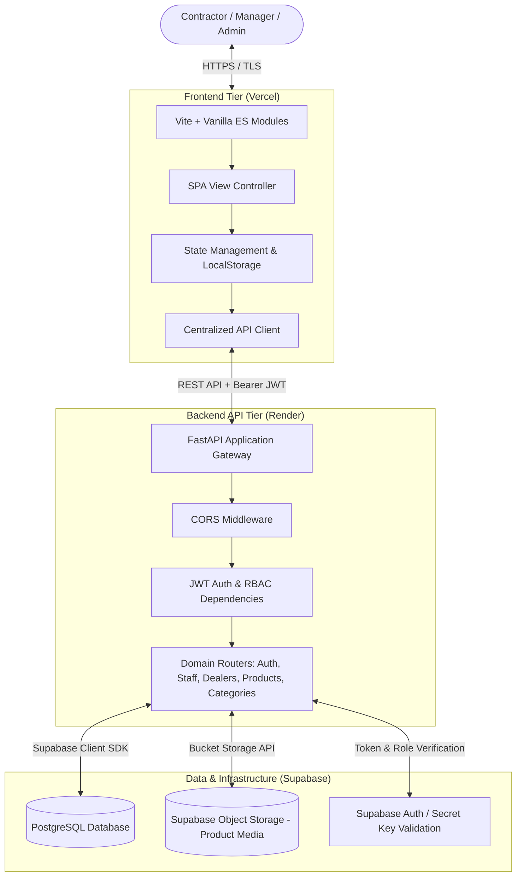

# RailPro — Railway Contractor & Dealer Supply Portal

A full-stack, cloud-native enterprise management portal designed for rail supply contractors, regional managers, and equipment dealers. RailPro streamlines industrial equipment sourcing, inventory tracking, dealer lifecycle management, and category curation with strict role-based access control (RBAC).

---

## 🌐 Live Deployments

| Component | Platform | URL |
| :--- | :--- | :--- |
| **Frontend Application** | Vercel | [https://railpro-liart.vercel.app](https://railpro-liart.vercel.app) |
| **Backend API** | Render | [https://railpro.onrender.com](https://railpro.onrender.com) |
| **Interactive API Documentation** | Swagger / OpenAPI | [https://railpro.onrender.com/docs](https://railpro.onrender.com/docs) |

---

## 🏛️ System Architecture

RailPro follows a decoupled, three-tier cloud architecture ensuring high availability, fast response times, and separation of concerns.



---

## 📦 Architecture Breakdown

### 1. Frontend Architecture (`/frontend`)
Built using a lightweight, performant **Vite + Vanilla ES6+ JavaScript** single-page architecture without heavy virtual DOM overhead.

- **Vite Bundler & Dev Server**: Instant hot-module reloading and optimized production tree-shaking.
- **Component & View Routing**: Declarative page routing (`home.js`, `auth.js`, `adminDashboard.js`, `managerDashboard.js`, `dealerDashboard.js`) managed through `main.js`.
- **Centralized API Client (`src/api/client.js`)**:
  - Unified HTTP request abstraction built on native `fetch()`.
  - Automatic environment detection (switches between `localhost:8000` and Render backend).
  - Transparent Bearer token injection from `localStorage`.
  - Global error normalization and HTTP status forwarding.
- **Design System & Styling (`src/style.css`)**:
  - Handcrafted modern responsive CSS design system.
  - Dark-mode aesthetics with glassmorphism, fluid typography, and CSS custom properties.
  - Micro-interactions, feedback toasts, and loading skeletons.

### 2. Backend Architecture (`/backend`)
Built using **Python 3.11+ and FastAPI**, prioritizing asynchronous I/O, rigorous schema validation, and modular domain separation.

- **FastAPI Core Gateway (`main.py`)**:
  - Global CORS policies configured for Vercel production domains and local development environments.
  - Centralized exception handlers ensuring standardized JSON error responses with proper CORS headers.
  - Automated interactive API documentation generated via OpenAPI and Swagger UI (`/docs`, `/redoc`).
- **Domain Routers (`app/routers/`)**:
  - `auth.py`: User registration, credential verification, and JWT session token generation.
  - `staff.py`: Administrative control over regional managers and internal operational staff.
  - `dealers.py`: Dealer verification workflows, status transitions (`pending`, `approved`, `rejected`), and inventory quotas.
  - `products.py`: Product catalogue CRUD operations, technical specification handling, and inventory stock tracking.
  - `categories.py`: Railway equipment taxonomy and hierarchical category management.
- **Security & Authorization (`app/core/`)**:
  - Stateless JSON Web Tokens (JWT) using `python-jose` with cryptographic HMAC-SHA256 signing.
  - Role-Based Access Control (RBAC) enforced via FastAPI Dependency Injection (`get_current_user`, `require_role`).
- **Database & Storage Layer (`app/database.py`)**:
  - Connection management through the official Supabase Python client.
  - Direct PostgreSQL persistence for transactional metadata and audit logs.
  - Supabase S3-compatible Object Storage for product imagery and technical documents.

---

## 👥 Role-Based Access Control (RBAC)

| Role | Permissions & Capabilities |
| :--- | :--- |
| **Admin** | Full system visibility; manage staff accounts; approve/reject dealers; manage categories; oversee global inventory and audit logs. |
| **Regional Manager** | Review regional dealer applications; monitor local stock levels; manage regional product listings; update order fulfilment statuses. |
| **Dealer / Contractor** | Browse approved equipment catalog; submit supplier applications; manage inventory listings; update pricing and available quantities. |

---

## 📂 Repository Directory Layout

```text
railpro/
├── README.md                           # Master project documentation
├── render.yaml                         # Render Infrastructure-as-Code blueprint
│
├── backend/                            # FastAPI backend service
│   ├── main.py                         # Application entrypoint & CORS configuration
│   ├── requirements.txt                # Python runtime dependencies
│   ├── render.yaml                     # Backend-specific Render deployment spec
│   ├── .env.example                    # Sample environment variables
│   └── app/
│       ├── config.py                   # Central settings & env loader
│       ├── database.py                 # Supabase client singleton
│       ├── core/
│       │   └── security.py             # JWT generation, hashing & auth dependencies
│       ├── routers/
│       │   ├── auth.py                 # Authentication endpoints
│       │   ├── staff.py                # Admin & staff operations
│       │   ├── dealers.py              # Dealer lifecycle endpoints
│       │   ├── categories.py           # Catalog category management
│       │   └── products.py             # Equipment inventory & storage uploads
│       ├── schemas/                    # Pydantic request/response validation schemas
│       └── services/                   # Business logic and external API integrations
│
└── frontend/                           # Vite SPA frontend client
    ├── index.html                      # HTML5 single-page application entrypoint
    ├── package.json                    # Node dependencies & run scripts
    ├── public/                         # Static assets, icons, and logos
    └── src/
        ├── main.js                     # Client router & app initialization
        ├── style.css                   # Core design system & responsive styling
        ├── api/
        │   ├── client.js               # Centralized HTTP client (auth headers, baseURL)
        │   ├── auth.js                 # Auth endpoints interface
        │   ├── categories.js           # Category API helpers
        │   ├── dealers.js              # Dealer API helpers
        │   ├── products.js             # Product catalog API helpers
        │   └── staff.js                # Staff API helpers
        ├── pages/                      # Role-specific dashboard views & pages
        │   ├── home.js                 # Public homepage & equipment catalog showcase
        │   ├── auth.js                 # Login & Registration views
        │   ├── adminDashboard.js       # Executive admin management console
        │   ├── managerDashboard.js     # Regional manager operational dashboard
        │   └── dealerDashboard.js      # Contractor & dealer portal
        ├── components/                 # Reusable UI widgets, modals, and navbars
        └── state/                      # Client-side user session & state helpers
```

---

## ⚙️ Environment Variables

### Backend Configuration (`backend/.env`)

Create a `.env` file in the `backend/` directory based on the following template:

```env
# Supabase Configuration
SUPABASE_URL=https://<your-project-id>.supabase.co
SUPABASE_KEY=<your-supabase-anon-public-key>
SUPABASE_SECRET_KEY=<your-supabase-service-role-key>

# JWT Authentication
SECRET_KEY=<your-strong-cryptographic-random-secret>

# Optional Initial Superadmin Seed Credentials
ADMIN_EMAIL=admin@railpro.com
ADMIN_PASSWORD=YourSecurePassword123!
```

---

## 🚀 Local Development Setup

### Prerequisites
- **Python**: version 3.10 or higher
- **Node.js**: version 18.0 or higher
- **npm**: version 9.0 or higher

### 1. Backend Setup
```bash
# Navigate to backend directory
cd backend

# Create and activate a Python virtual environment
python3 -m venv venv
source venv/bin/activate  # On Windows: venv\Scripts\activate

# Install dependencies
pip install -r requirements.txt

# Create local environment file
cp .env.example .env  # Update with your Supabase credentials

# Start the development server
uvicorn main:app --reload --host 127.0.0.1 --port 8000
```
The API will be available at `http://127.0.0.1:8000` and interactive docs at `http://127.0.0.1:8000/docs`.

### 2. Frontend Setup
```bash
# Open a new terminal and navigate to frontend directory
cd frontend

# Install dependencies
npm install

# Start the Vite development server
npm run dev
```
The frontend will be available at `http://localhost:5173`.

---

## 🚢 Deployment Architecture

```text
┌─────────────────────────────────┐       ┌─────────────────────────────────┐
│     Frontend (Vercel CDN)       │       │    Backend (Render Web Service) │
│  • Edge-cached static bundle    │ ────> │  • Python 3.11 + Uvicorn        │
│  • Automatic GitHub CD triggers │       │  • Auto-restarts & Health checks│
└─────────────────────────────────┘       └────────────────┬────────────────┘
                                                           │
                                                           ▼
                                          ┌─────────────────────────────────┐
                                          │     Database & Media Storage    │
                                          │  • Supabase Managed PostgreSQL  │
                                          │  • S3-Compatible Media Buckets  │
                                          └─────────────────────────────────┘
```

- **Frontend (Vercel)**: Automatically deployed from the `main` branch. Assets are distributed globally through Vercel's Edge Network with client-side rewrite rules for single-page routing.
- **Backend (Render)**: Hosted as a Render Python Web Service configured via `render.yaml`. Environment variables (`SUPABASE_URL`, `SUPABASE_KEY`, `SUPABASE_SECRET_KEY`, `SECRET_KEY`) are injected securely through Render's secret management.
- **Database & Media (Supabase Cloud)**: Cloud PostgreSQL instance handling relational business data and asset storage buckets with granular access permissions.

---

## 📄 License
This project is proprietary software developed for the RailPro Contractor & Dealer Network.
